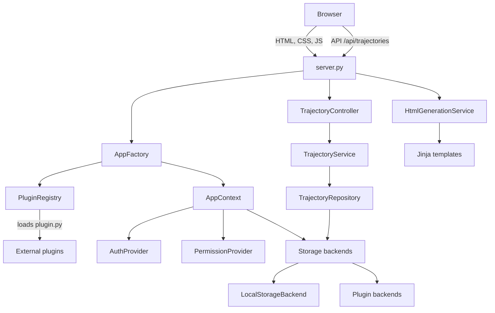
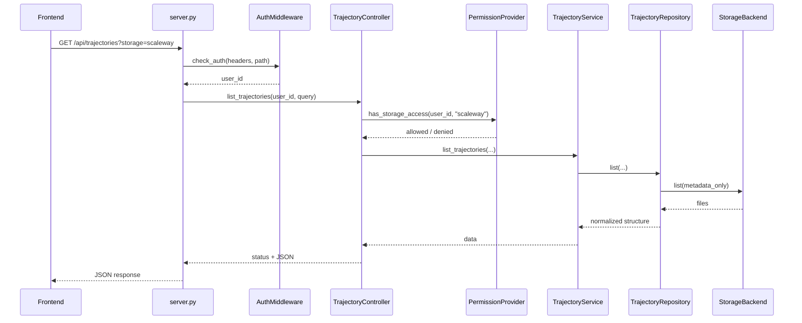
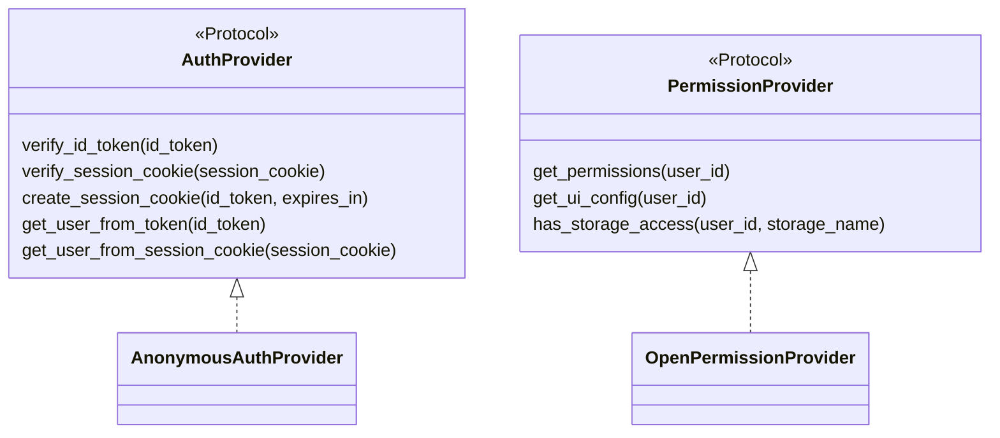
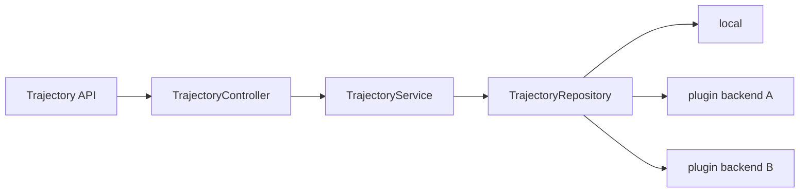
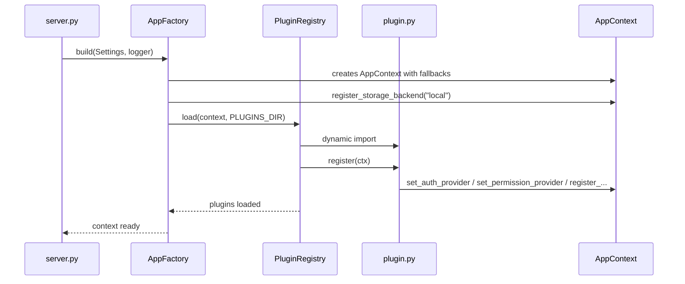

# Mission Studio

Web application for planning agricultural missions on the SRBC robot (JSON Agri v3): farm folder, parcels, equipment twin, coverage planning, expert path editor, geometric simulation and versioned publication.

> **Project status: working prototype for field trials and personal use, not yet a product for mass distribution.**
> The full mission chain runs and is covered by automated tests, but several features still need polishing, and the interface, the user experience, the upsell and the farmers' day-to-day workflow have to be validated through a wider field deployment. See [`docs/PROJECT_STATUS.md`](docs/PROJECT_STATUS.md) and the [open issues](https://github.com/Sustainable-Robotics-Base-for-Crops/mission_studio/issues).
>
> **Statut (FR) :** prototype fonctionnel pour des essais terrain et un usage personnel. Certaines fonctionnalités restent à parfaire ; un déploiement plus large auprès d'agriculteurs est nécessaire pour valider l'IHM, l'expérience utilisateur, l'offre commerciale et le parcours métier avant une diffusion massive.

Mission Studio is not a branch of [`trajectory_editor`](https://github.com/Sustainable-Robotics-Base-for-Crops/trajectory_editor): that repository stays the compact editor (`/app`). Mission Studio grew far enough to live in its own repo; it still ships the compact editor at `/app` for compatibility.

## Authors and credits

- **Mission Studio** (`/studio`: React shell, MapLibre map, farm folder, parcels, equipment twin, coverage, expert editor, simulation, publication, imports, and the test suite) is designed and developed by **Alexandre PREVAULT-OSMANI** ([@Alexandre-PO](https://github.com/Alexandre-PO)), SABI AGRI.
- The **compact editor and server core** it was built on (`/app`, `server.py`, `backend/` core, plugin system, `public/js`, `public/css`) come from [`trajectory_editor`](https://github.com/Sustainable-Robotics-Base-for-Crops/trajectory_editor), started in 2026 by the SABI AGRI team ([@florianSabi](https://github.com/florianSabi) and colleagues). The first commit of this repository imports that code; its detailed history lives in `trajectory_editor`.
- Coverage planning optionally uses [Fields2Cover](https://github.com/Fields2Cover/Fields2Cover) (BSD-3-Clause), see [`NOTICE`](NOTICE).

## Contributing

Feedback from farmers, integrators and robot makers is the most useful contribution at this stage: open an issue describing your farm, crop and machine, and what blocked you. Code contributions are welcome through pull requests; run `./scripts/check.sh` before opening one. This project is licensed under the [Apache License 2.0](LICENSE).

## Quick start

Run locally (Python ≥ 3.12, Node 22):

```bash
cd mission_studio
python3 -m venv .venv && source .venv/bin/activate
pip install -r requirements.txt
npm ci && npm run build     # rebuild after frontend changes
BACKEND_FASTAPI=true python server.py
# http://localhost:3000/studio
```

Mission Studio is meant to run on your own machine. The public-server mode (no state written on the server, rate limits, restricted CORS) is not finished: do not expose this server on the Internet as is.

The rest of this README describes the shared public core (HTTP API, plugins, legacy `/app`). Auth, cloud storage, and other deployment-specific integrations stay out of this package: they load at startup through the plugin system.

## Table Of Contents

- [Authors and credits](#authors-and-credits)
- [Contributing](#contributing)
- [Quick start](#quick-start)
- [Package Role](#package-role)
- [Architecture](#architecture)
- [Project Structure](#project-structure)
- [Installation](#installation)
- [Configuration](#configuration)
- [Startup](#startup)
- [HTTP API](#http-api)
- [Authentication And Permissions](#authentication-and-permissions)
- [Trajectory Storage](#trajectory-storage)
- [Frontend](#frontend)
- [Plugins](#plugins)
- [Security](#security)
- [Operations](#operations)

## Package Role

The public core manages:

- the Python HTTP server (`http.server` by default; FastAPI + Uvicorn when `BACKEND_FASTAPI=true`);
- HTML rendering through Jinja2;
- the modular JavaScript frontend application;
- trajectory business validation;
- local storage in `backend/uploads`;
- authentication, permission, and storage contracts;
- optional loading of external plugins through `PLUGINS_DIR`.

The public core does not contain:

- authentication secrets;
- configuration tied to a specific external provider;
- account-specific business logic;
- mandatory dependencies on a cloud service.

## Architecture



The server builds an `AppContext` on first startup. This context contains the active providers and storage backends. Without plugins, the default providers are:

- `AnonymousAuthProvider`, which runs the application without external authentication;
- `OpenPermissionProvider`, which allows features in simple public mode;
- `LocalStorageBackend`, which saves files locally.

## Project Structure

```text
mission_studio/
  backend/
    auth/                 # AuthProvider contract + anonymous fallback
    api/                  # FastAPI app, legacy /api/trajectories, /api/v1
    db/                   # SQLite connection and schema
    fields/               # Field / zone / obstacle / guidance-line catalogue
    imports/              # Third-party file adapters (Naïo, Raven, GeoJSON, SHP)
    jobs/                 # Local job queue (echo worker)
    data/                 # studio.sqlite when FastAPI is on (gitignored)
    config/               # .env configuration loading
    controllers/          # Business HTTP controllers
    core/                 # AppContext, AppFactory, PluginRegistry
    middleware/           # Auth, validation, rate limiting, errors
    models/               # Python business models
    permissions/          # PermissionProvider contract + open fallback
    repositories/         # Storage access
    services/             # Business services and HTML rendering
    storage/              # StorageBackend contract + local backend
    templates/            # Jinja templates
    uploads/              # Local trajectory storage
  docs/
    IMPORTS.md            # Third-party imports + object-creation plan
    PLUGINS.md            # Plugin system reference
  public/
    css/
    js/
  env.example
  requirements.txt
  server.py
  start.py
```

## Installation

Requirements:

- Python 3.12, or a version compatible with the dependencies used;
- `pip`;
- a virtual environment is recommended.

Minimal installation:

```bash
cd trajectory_editor
python -m venv .venv
source .venv/bin/activate
pip install -r requirements.txt
cp env.example .env
```

Public core dependencies:

```text
python-dotenv>=1.0.0
Jinja2>=3.1.0
jsonschema>=4.0.0
fastapi>=0.115.0,<1
uvicorn>=0.32.0,<1
```

Plugins may declare their own dependencies in their respective repositories. They must be installed in the same Python environment as the public server.

## Configuration

`Settings` first loads a `.env` file at the parent repository root, then loads the project `.env` with priority.

Main variables:

| Variable | Default | Description |
| --- | --- | --- |
| `PORT` | `3000` | HTTP server port. |
| `HOST` | `localhost` | Listening interface. |
| `DEBUG` | `false` | Application debug flag. |
| `APP_LOGO_PATH` | `` | Local file path, absolute web path, or URL used as the application logo. |
| `PLUGINS_DIR` | empty | Directory containing external plugins. |
| `MAP_TILE_PROVIDER` | `esri` | Map tile provider exposed to the frontend. |
| `MAP_TILE_API_KEY` | empty | Optional key for the tile provider. |
| `MAP_TILE_URL` | empty | Custom tile URL when needed. |
| `MAP_TILE_ATTRIBUTION` | empty | Map attribution. |
| `MAP_TILE_MAX_ZOOM` | `22` | Maximum zoom level. |
| `MAP_TILE_MAX_NATIVE_ZOOM` | `19` | Maximum native zoom level. |
| `MAP_TILE_GOOGLE_MAP_TYPE` | `satellite` | Google map type for `createSession` (`roadmap`, `satellite`, `terrain`). |
| `MAP_TILE_GOOGLE_LANGUAGE` | `fr-FR` | Google Map Tiles session language. |
| `MAP_TILE_GOOGLE_REGION` | `FR` | Google Map Tiles session region. |
| `MAP_SEARCH_PROVIDER` | `nominatim` | Place search provider (`nominatim`, `photon`, `google`). |
| `MAP_SEARCH_API_KEY` | empty | Optional key for the search provider, required for Google. |
| `MAP_SEARCH_URL` | empty | Custom search provider URL when needed. |
| `MAP_SEARCH_LIMIT` | `5` | Maximum number of suggestions shown under the search field. |
| `MAP_SEARCH_COUNTRY_CODES` | empty | Optional country restriction for Nominatim (`fr,be,ch`). Empty means worldwide. |
| `BACKEND_FASTAPI` | `false` | When true, serve with Uvicorn + FastAPI instead of `http.server`. |
| `SQLITE_PATH` | `backend/data/studio.sqlite` | Studio catalogue / job queue (created only under FastAPI). |

Example:

```env
PORT=3000
HOST=localhost
DEBUG=false
PLUGINS_DIR=/path/to/plugins
MAP_TILE_PROVIDER=esri
```

For Google Map Tiles API, define at least:

```env
MAP_TILE_PROVIDER=google
MAP_TILE_API_KEY=your_google_api_key
MAP_TILE_GOOGLE_MAP_TYPE=satellite
```

The frontend automatically creates a Google `createSession` session before loading `2dtiles`.

Place search goes through `/api/geocoding/search` so the provider can be changed without modifying the frontend. By default, `MAP_SEARCH_PROVIDER=nominatim` searches worldwide and returns multiple suggestions that the user can choose from.

## Startup

Without plugins:

```bash
cd trajectory_editor
python server.py
```

With plugins:

```bash
cd trajectory_editor
PLUGINS_DIR=/path/to/plugins python server.py
```

The server exposes:

- `/` and `/login`: redirect to `/app` without external auth, or show the login page when an auth provider is loaded;
- `/app`: main application;
- `/api/trajectories`: listing and saving API;
- `/api/trajectories/{path}`: read, update, and delete API;
- `/_plugins/...`: static assets exposed by plugins.

## HTTP API

### General Flow



### Trajectory Endpoints

| Method | Path | Description |
| --- | --- | --- |
| `GET` | `/api/trajectories` | Lists trajectories. Accepts `storage` and `metadata`. |
| `GET` | `/api/trajectories/{path}` | Loads a trajectory. Accepts `storage` and `download=true`. |
| `POST` | `/api/trajectories` | Saves a trajectory. The target backend is defined by `X-Storage-Mode`. |
| `PUT` | `/api/trajectories/{path}` | Saves a trajectory while forcing the filename from the URL. |
| `DELETE` | `/api/trajectories/{path}` | Deletes a trajectory. |

### Studio catalogue and jobs (`BACKEND_FASTAPI=true`)

| Method | Path | Description |
| --- | --- | --- |
| `GET` | `/api/v1/health` | Transport health (`sqlite`, `jobs`). |
| `POST` | `/api/v1/jobs` | Enqueue a job (`kind`, optional `payload`). Returns 202. Kind `echo` only in this cut. |
| `GET` | `/api/v1/jobs` | List jobs. |
| `GET` | `/api/v1/jobs/{id}` | Job status / result. |
| `GET` / `POST` | `/api/v1/fields` | List or create a field. |
| `POST` | `/api/v1/fields/import` | Import GeoJSON (`format` other than `geojson` → 400). |
| `GET` / `PATCH` / `DELETE` | `/api/v1/fields/{id}` | Read, update, or delete a field. |
| `GET` | `/api/v1/fields/{id}/export` | Export a GeoJSON FeatureCollection. |
| `POST` | `/api/v1/fields/{id}/zones` | Add a typed zone (CdCF §8.2, FR aliases accepted). |
| `POST` | `/api/v1/fields/{id}/obstacles` | Add an obstacle. |
| `POST` | `/api/v1/fields/{id}/guidance-lines` | Add a named LineString (MAP-010). |
| `PATCH` / `DELETE` | `/api/v1/fields/{id}/guidance-lines/{line}` | Rename or delete a guidance line. |
| `POST` | `/api/v1/fields/{id}/row-sets` | Add numbered catalogue rows (MAP-011, L6). |
| `DELETE` | `/api/v1/fields/{id}/row-sets/{set}` | Delete a row set and its rows. |
| `PATCH` / `DELETE` | `/api/v1/fields/{id}/rows/{row}` | Rename or delete one row. |
| `POST` | `/api/v1/fields/{id}/traffic-ways` | Add a site path LineString (MAP-013 first cut). |
| `PATCH` / `DELETE` | `/api/v1/fields/{id}/traffic-ways/{way}` | Rename, set one-way / speed, or delete a path. |
| `POST` | `/api/v1/fields/{id}/traffic-nodes` | Add a named Point (gate / service / stop / intersection). |
| `PATCH` / `DELETE` | `/api/v1/fields/{id}/traffic-nodes/{node}` | Rename, change kind, or delete a traffic point. |
| `GET` | `/api/v1/fields/{id}/versions` | Version list. |
| `GET` | `/api/v1/fields/{id}/versions/{a}/diff/{b}` | Geometry hash / area / child counts. |
| `POST` | `/api/v1/fields/{id}/missions` | Link a mission path. |
| `GET` | `/api/v1/fields/{id}/impact` | Invalidation banner for linked missions. |

| `GET` | `/api/v1/equipment` | Vehicles, implements and combinations (L7a). |
| `GET` / `POST` / `PATCH` / `DELETE` | `/api/v1/equipment/vehicles[/{id}]` | Vehicle twins. OEM rows cannot be deleted. |
| `GET` / `POST` / `PATCH` / `DELETE` | `/api/v1/equipment/implements[/{id}]` | Implements (physical width ≠ working width). |
| `GET` | `/api/v1/equipment/combinations/{id}` | Combination + envelope + `srbc_equipment` snapshot. |
| `GET` | `/api/v1/coverage/engine` | Planner in use (`fields2cover` or `parallel_fallback`). |
| `POST` | `/api/v1/coverage/plan` | Polygon or catalogue `row_set` → Agri `row_line` (L8a). |
| `GET` | `/api/v1/imports/adapters` | Third-party dialects Studio can read (L14). |
| `POST` | `/api/v1/imports/preview` | Vendor file → recognised figures + overlay collection. |

The field catalogue and equipment twins live in SQLite. Agri v3 files under `backend/uploads/` remain the robot export. See `docs/AGRI_FORMAT_EVOLUTION.md` for `metadata` conventions (no schema v4).

Imported vendor files (Naïo work maps, Raven job exports, plain GeoJSON or shapefiles) become session overlays only: nothing is written to the catalogue or to the farm folder. See `docs/IMPORTS.md`, including the plan for creating objects from an import in a later lot.

Storage parameters:

- `storage=local`: reads from local storage;
- `storage=<plugin_name>`: reads from a plugin backend;
- no `storage`: lists or searches according to the available backend order;
- `X-Storage-Mode: local`: saves locally;
- `X-Storage-Mode: <plugin_name>`: saves to a plugin backend;
- `X-Storage-Mode: both`: saves to all registered backends.

## Authentication And Permissions

The public core only exposes contracts. Real providers are injected by plugins.



Default behavior:

- without an auth plugin, the application runs in anonymous mode;
- if a plugin replaces the anonymous provider, `/app` becomes protected;
- plugin routes under `/api/auth/...` may be exposed before middleware verification;
- UI permissions are computed server-side, then injected into `window.TRAJECTORY_EDITOR_UI_CONFIG`.

The frontend must not be treated as a security boundary. Access checks for non-local storage must remain enforced server-side through `PermissionProvider.has_storage_access(...)`.

## Trajectory Storage

Local storage is always registered under the `local` name.



Path format used for saves:

```text
{file_type}/{vehicle_id}/{filename}.json
```

The repository also normalizes entries returned by backends so the frontend receives a structure that can be grouped by type and vehicle.

## Frontend

The frontend is organized around global JavaScript modules:

- `EventBus`: event bus;
- `ApiService`: HTTP calls;
- `MapService` / `MapView` / `MapController`: map display and interactions;
- `PanelView`: side panel;
- `TrajectoryController` / `SectionController` / `TrajectoryEditor`: editor logic;
- `UIController`: applies UI configuration derived from permissions;
- `custom_plugins`: runtime registry exposed to frontend plugins.

Map configuration is injected into:

```javascript
window.TRAJECTORY_EDITOR_MAP_CONFIG
```

UI configuration derived from permissions is injected into:

```javascript
window.TRAJECTORY_EDITOR_UI_CONFIG
```

A frontend plugin must check this configuration before creating sensitive elements in the DOM.

## Plugins

The plugin system is documented in `docs/PLUGINS.md`.

A plugin can:

- replace authentication;
- replace the permission provider;
- add a storage backend;
- add HTTP routes;
- add Jinja templates;
- expose static assets;
- inject partials into the planned slots.

Loading:



## Security

Important points:

- `trajectory_editor` must not contain external provider secrets.
- Credentials must live in plugins, local `.env` files, or a secret manager.
- UI permissions are not enough; the API must verify permissions server-side.
- Sensitive buttons or actions must not be created in the DOM if the server config does not allow them.
- File paths received by the API are sanitized, and uploaded filenames are limited to a basename.
- The current CORS configuration is minimal and must be reviewed if the application is exposed publicly or consumed cross-origin.

## Operations

Check startup:

```bash
python server.py
```

Check loaded plugins in logs:

```text
[plugins] Loaded: my_auth_plugin
[plugins] Loaded: my_permissions_plugin
[plugins] Loaded: my_storage_plugin
```

Quickly compile Python files:

```bash
python -m py_compile server.py backend/**/*.py
```

Update dependencies:

```bash
pip install -r requirements.txt
```

For a systemd deployment, point the service to `server.py` in the project directory and define `PLUGINS_DIR` in the service environment if plugins must be loaded.
