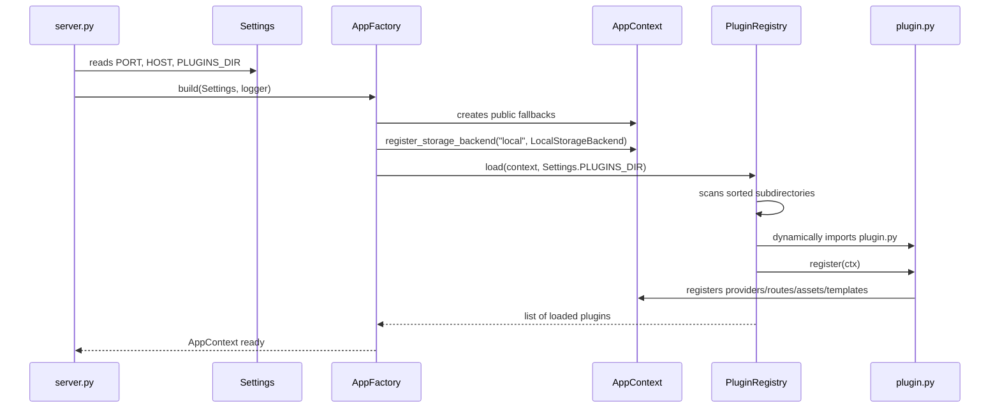
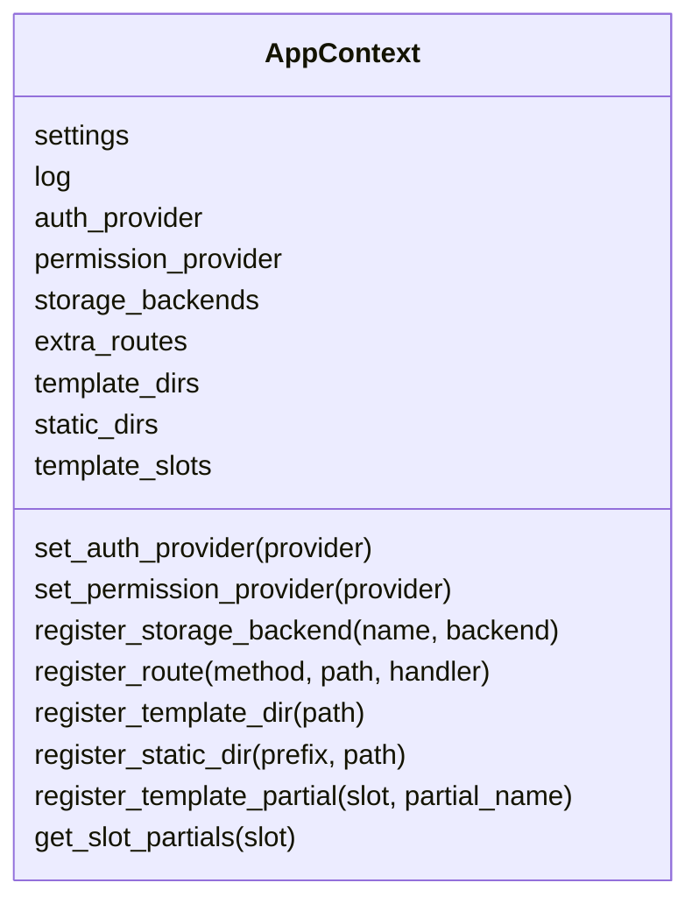
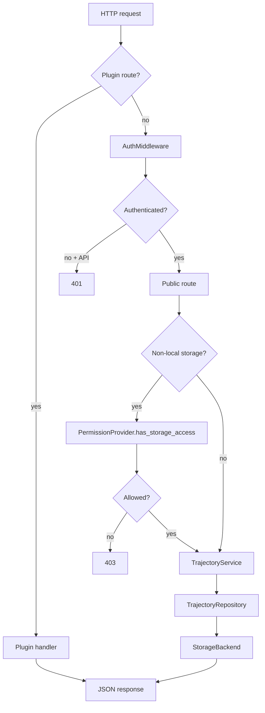

# Plugin System

`trajectory_editor` exposes a plugin system to connect deployment-specific components without modifying the public core. A plugin is a directory containing a `plugin.py` file with a `register(ctx)` function.

Plugins can provide:

- an authentication provider;
- a permission provider;
- a storage backend;
- additional HTTP routes;
- Jinja templates;
- static assets;
- frontend scripts connected to `window.custom_plugins`.

## Principles

- The public core remains agnostic to the technologies chosen by a deployment.
- Provider-specific secrets and dependencies stay in plugins.
- The public core defines contracts; plugins implement them.
- A plugin should be addable or removable without changing `trajectory_editor`.
- Sensitive access checks must be enforced server-side.

## Plugin Loading

A plugin directory contains one subdirectory per plugin:

```text
/path/to/plugins/
  my_auth_plugin/
    plugin.py
  my_permissions_plugin/
    plugin.py
  my_storage_plugin/
    plugin.py
```

The path is provided by the `PLUGINS_DIR` environment variable.

```bash
PLUGINS_DIR=/path/to/plugins python server.py
```

If `PLUGINS_DIR` is empty, missing, `none`, `false`, or `disabled`, no plugin is loaded.

### Loading Flow



### Loading Order

`PluginRegistry` scans entries in `PLUGINS_DIR` in alphabetical order. If several plugins replace the same provider, the last loaded plugin overrides the previous provider.

Example:

```text
my_auth_plugin
my_permissions_plugin
my_storage_plugin
```

In this case:

- `my_auth_plugin` can replace the auth provider;
- `my_permissions_plugin` can use the already injected `ctx.auth_provider`;
- `my_storage_plugin` can register its storage backend.

## Entry Point

Each plugin must expose:

```python
def register(ctx) -> None:
    ...
```

The `ctx` context is an `AppContext` instance.



Available methods:

| Method | Role |
| --- | --- |
| `ctx.set_auth_provider(provider)` | Replaces the active authentication provider. |
| `ctx.set_permission_provider(provider)` | Replaces the active permission provider. |
| `ctx.register_storage_backend(name, backend)` | Adds a storage backend usable by the trajectory API. |
| `ctx.register_route(method, path, handler)` | Adds an HTTP route handled by the plugin. |
| `ctx.register_template_dir(path)` | Adds a Jinja template directory. |
| `ctx.register_static_dir(prefix, path)` | Exposes a static directory. |
| `ctx.register_template_partial(slot, partial_name)` | Injects a Jinja partial into a slot. |
| `ctx.log` | Application logger. |
| `ctx.settings` | Active public configuration. |

## Authentication Contract

An auth provider must implement the interface from `backend/auth/base.py`.

```python
from dataclasses import dataclass
from typing import Optional

@dataclass
class AuthUser:
    uid: str
    email: Optional[str] = None

class MyAuthProvider:
    def verify_id_token(self, id_token: str) -> dict | None:
        ...

    def verify_session_cookie(self, session_cookie: str) -> dict | None:
        ...

    def create_session_cookie(self, id_token: str, expires_in: int | None = None) -> tuple[str, int] | None:
        ...

    def get_user_from_token(self, id_token: str) -> AuthUser | None:
        ...

    def get_user_from_session_cookie(self, session_cookie: str) -> AuthUser | None:
        ...
```

Registration:

```python
def register(ctx):
    provider = MyAuthProvider()
    ctx.set_auth_provider(provider)
```

### Authentication Routes

An auth plugin can register its own routes.

```python
from http import HTTPStatus

def create_session(payload, headers, client_address):
    id_token = payload.get("idToken")
    ...
    return (
        HTTPStatus.OK,
        {
            "status": "success",
            "setCookie": "session=...; Path=/; HttpOnly; SameSite=Strict",
        },
    )

def delete_session(headers, client_address):
    return (
        HTTPStatus.OK,
        {
            "success": True,
            "deleteCookie": "session=; Max-Age=0; Path=/; HttpOnly; SameSite=Strict",
        },
    )

def register(ctx):
    ctx.register_route("POST", "/api/auth/session", create_session)
    ctx.register_route("DELETE", "/api/auth/session", delete_session)
```

The public server turns the following special response keys into HTTP headers:

| Response key | Effect |
| --- | --- |
| `setCookie` | Adds a `Set-Cookie` header. |
| `deleteCookie` | Adds a deleting `Set-Cookie` header. |

Routes under `/api/auth/` are accessible before the auth middleware check so sessions can be created or deleted.

## Permission Contract

A permission provider must implement the interface from `backend/permissions/base.py`.

```python
class MyPermissionProvider:
    def get_permissions(self, user_id: str) -> dict:
        ...

    def get_ui_config(self, user_id: str) -> dict:
        return {
            "ui": {
                "showCloudButtons": False,
                "showAdvancedFeatures": False,
                "allowedFileTypes": ["draft", "mission_order", "parcel_map"],
                "userLevel": 0,
            }
        }

    def has_storage_access(self, user_id: str, storage_name: str) -> bool:
        ...
```

Registration:

```python
def register(ctx):
    ctx.set_permission_provider(MyPermissionProvider())
```

### UI Configuration

The public core calls `get_ui_config(user_id)` while rendering `/app`. The result is injected into:

```javascript
window.TRAJECTORY_EDITOR_UI_CONFIG
```

Example:

```json
{
  "ui": {
    "showCloudButtons": false,
    "showAdvancedFeatures": true,
    "allowedFileTypes": ["draft", "mission_order"],
    "userLevel": 4
  }
}
```

A frontend plugin must read this configuration before creating sensitive DOM elements. If a permission is false, the plugin must not create the corresponding button or action.

### Server Authorization

`get_ui_config` controls the interface. Real authorization must be enforced by `has_storage_access`.

The trajectory controller calls `has_storage_access(user_id, storage_name)` before non-local operations:

- saving to a plugin backend;
- reading from a plugin backend;
- listing a plugin backend.

## Storage Contract

A storage backend must implement the interface from `backend/storage/base.py`.

```python
class MyStorageBackend:
    name = "my_storage"

    def save(self, filepath: str, data: str) -> bool:
        ...

    def load(self, filepath: str) -> str | None:
        ...

    def delete(self, filepath: str) -> bool:
        ...

    def list(self, metadata_only: bool = False) -> list[dict]:
        ...
```

Registration:

```python
def register(ctx):
    backend = MyStorageBackend()
    ctx.register_storage_backend("my_storage", backend)
```

`local` is reserved for the public local backend. Other names are free, but they must remain stable on the frontend side.

### Path Format

The public core saves trajectories using:

```text
{file_type}/{vehicle_id}/{filename}.json
```

Example:

```text
mission_order/tractor-42/mission-a.json
```

### List Format

A backend can return at least:

```python
{
    "Key": "mission_order/tractor-42/mission-a.json",
    "Size": 12345,
    "storage": "my_storage",
}
```

or:

```python
{
    "filename": "mission-a.json",
    "fullPath": "mission_order/tractor-42/mission-a.json",
    "storage": "my_storage",
    "size": 12345,
}
```

The public repository then normalizes entries into groups usable by the frontend:

```json
[
  {
    "type": "mission_order",
    "vehicles": {
      "tractor-42": [
        {
          "filename": "mission-a.json",
          "fullPath": "mission_order/tractor-42/mission-a.json",
          "actualPath": "mission_order/tractor-42/mission-a.json",
          "storage": "my_storage"
        }
      ]
    }
  }
]
```

## Plugin Routes

A plugin can register an additional HTTP route:

```python
def handler(payload, headers, client_address):
    return (200, {"ok": True})

def register(ctx):
    ctx.register_route("POST", "/api/my-plugin/action", handler)
```

Expected signatures:

| Method | Handler signature |
| --- | --- |
| `POST`, `PUT` | `(payload, headers, client_address)` |
| `GET`, `DELETE` | `(headers, client_address)` |

Handlers always return:

```python
(status_code, response_data)
```

`response_data` can be a JSON-serializable dictionary or list.

## Templates And Assets

### Template Directories

```python
ctx.register_template_dir("/absolute/path/to/templates")
```

Plugin template directories are appended after the public template directory.

### Static Assets

```python
ctx.register_static_dir("/_plugins/my_plugin", "/absolute/path/to/static")
```

A `static/js/plugin.js` file will be accessible at:

```text
/_plugins/my_plugin/js/plugin.js
```

### Jinja Slots

Available slots:

| Slot | Location |
| --- | --- |
| `plugin_head_scripts` | In `<head>`, after `js/core/plugins.js`. |
| `plugin_body_pre` | At the beginning of `<body>`, before the application. |
| `plugin_header_extra_buttons` | In `#pluginHeaderActions`. |
| `plugin_body_scripts` | At the end of `<body>`, after the main app. |

Registration:

```python
ctx.register_template_partial("plugin_body_scripts", "partials/my_plugin_scripts.html")
```

Partial:

```html
<script src="/_plugins/my_plugin/js/plugin.js"></script>
```

## Frontend Plugin

The public core exposes `window.custom_plugins` through `public/js/core/plugins.js`.

Available functions:

| Function | Role |
| --- | --- |
| `registerAuthManager(authImpl)` | Replaces the frontend auth manager. |
| `registerCloudStorage(name, impl)` | Registers a frontend cloud integration. |
| `registerExtraButton(buttonDef)` | Declares an additional button controlled by the editor. |
| `getExtraButtons()` | Returns declared buttons. |
| `on(eventName, callback)` | Listens to a registry event. |
| `emit(eventName, payload)` | Emits an event. |

### Dynamic Buttons

A plugin must only create a sensitive button if server configuration allows it.

```javascript
(function initMyCloudPlugin() {
    if (!window.custom_plugins) return;

    const uiConfig = window.TRAJECTORY_EDITOR_UI_CONFIG;
    if (uiConfig?.ui?.showCloudButtons !== true) {
        return;
    }

    const header = document.getElementById("pluginHeaderActions");
    if (!header) return;

    const button = document.createElement("button");
    button.id = "saveMyCloudBtn";
    button.className = "btn btn-success";
    button.textContent = "Save Cloud";
    header.appendChild(button);

    window.custom_plugins.registerExtraButton({
        id: "saveMyCloudBtn",
        requiresPermission: "showCloudButtons",
        onClick: (editor) => editor.saveTrajectoryCloud("my_storage"),
    });
})();
```

Hiding an unauthorized button with CSS is not enough: the button must not be created in the DOM if the server permission is false.

## Minimal Storage Plugin Example

```text
plugins/
  my_storage/
    plugin.py
    backend/
      my_storage_backend.py
    templates/
      partials/
        my_storage_scripts.html
    static/
      js/
        my_storage.js
```

`plugin.py`:

```python
from pathlib import Path
from backend.my_storage_backend import MyStorageBackend

ROOT = Path(__file__).resolve().parent

def register(ctx):
    ctx.register_storage_backend("my_storage", MyStorageBackend())
    ctx.register_template_dir(str(ROOT / "templates"))
    ctx.register_static_dir("/_plugins/my_storage", str(ROOT / "static"))
    ctx.register_template_partial("plugin_body_scripts", "partials/my_storage_scripts.html")
```

`templates/partials/my_storage_scripts.html`:

```html
<script src="/_plugins/my_storage/js/my_storage.js"></script>
```

## Minimal Permission Plugin Example

```python
class StaticPermissionProvider:
    def get_permissions(self, user_id: str) -> dict:
        return {"userLevel": 1, "cloud": False}

    def get_ui_config(self, user_id: str) -> dict:
        return {
            "ui": {
                "showCloudButtons": False,
                "showAdvancedFeatures": True,
                "allowedFileTypes": ["draft", "mission_order", "parcel_map"],
                "userLevel": 1,
            }
        }

    def has_storage_access(self, user_id: str, storage_name: str) -> bool:
        return storage_name == "local"

def register(ctx):
    ctx.set_permission_provider(StaticPermissionProvider())
```

## Minimal Auth Plugin Example

```python
from backend.auth.base import AuthUser

class HeaderAuthProvider:
    def verify_id_token(self, id_token: str) -> dict | None:
        return {"uid": id_token} if id_token else None

    def verify_session_cookie(self, session_cookie: str) -> dict | None:
        return {"uid": session_cookie} if session_cookie else None

    def create_session_cookie(self, id_token: str, expires_in: int | None = None):
        return None

    def get_user_from_token(self, id_token: str):
        return AuthUser(uid=id_token) if id_token else None

    def get_user_from_session_cookie(self, session_cookie: str):
        return AuthUser(uid=session_cookie) if session_cookie else None

def register(ctx):
    ctx.set_auth_provider(HeaderAuthProvider())
```

## Request Lifecycle With A Plugin



## Decoupling Rules

To keep a plugin portable:

- do not modify `trajectory_editor` to add a provider;
- use only the public contracts;
- keep plugin dependencies in the plugin's own `requirements.txt`;
- load plugin configuration from its own `.env` file or from the environment;
- choose explicit and stable storage names;
- never expose a secret in a template or JavaScript file;
- do not create a sensitive DOM element if server UI config does not allow it;
- keep access checks server-side, even if the UI hides or omits an action.

## Debugging

Useful startup logs:

```text
[plugins] No PLUGINS_DIR defined
[plugins] Loaded: my_auth_plugin
[plugins] Auth provider injected: MyAuthProvider
[plugins] Permission provider injected: MyPermissionProvider
[plugins] Storage backend registered: scaleway
```

Check loaded plugins:

```bash
PLUGINS_DIR=/path/to/plugins python server.py
```

Check that a plugin is detectable:

```text
plugins/my_plugin/plugin.py
```

Check imports:

```bash
python -m py_compile plugins/my_plugin/plugin.py
```

If a plugin is not loaded:

- check `PLUGINS_DIR`;
- check that the directory contains a `plugin.py`;
- check that `register(ctx)` exists;
- check the plugin's Python dependencies;
- read the `[plugins]` logs.

## Known Limitations

- Loading happens at startup, not hot-reload.
- Loading order is alphabetical.
- There is no execution sandbox: a Python plugin has the same rights as the server process.
- The public server CORS configuration must be adapted if plugins expose cross-origin flows.
- Plugins must remain compatible with the public contracts documented here.
